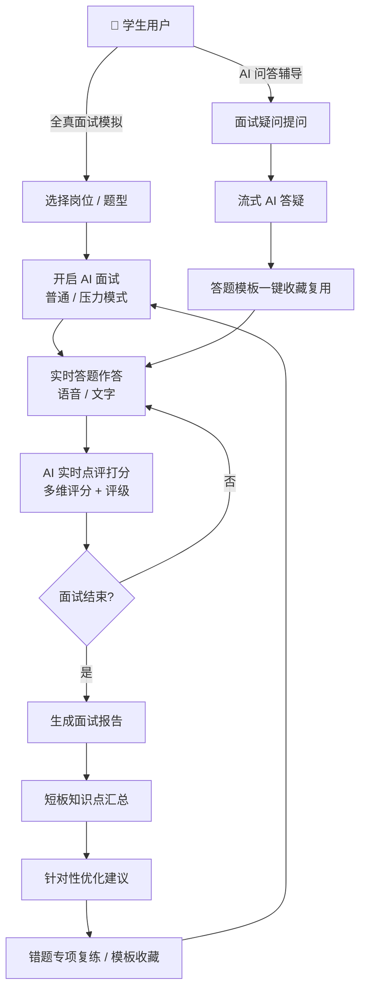
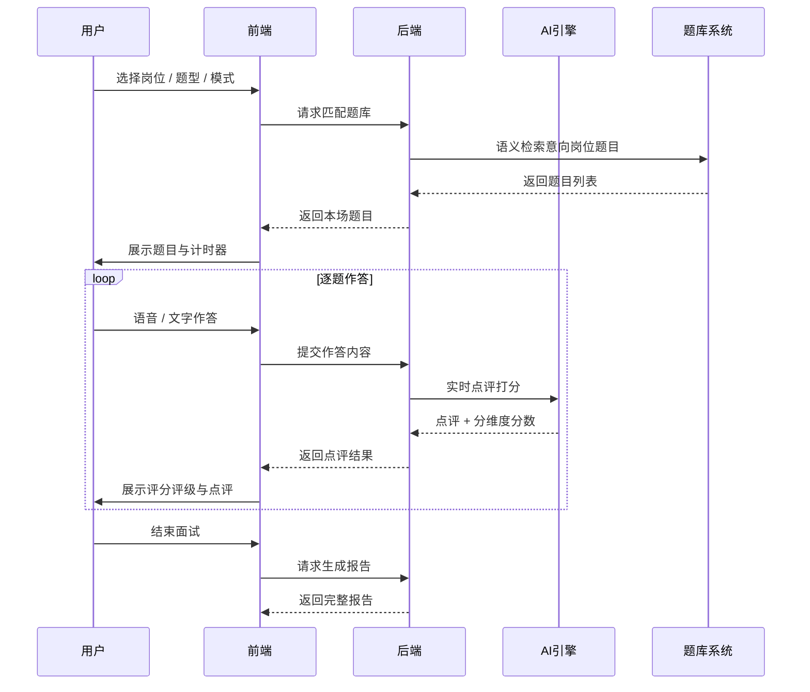
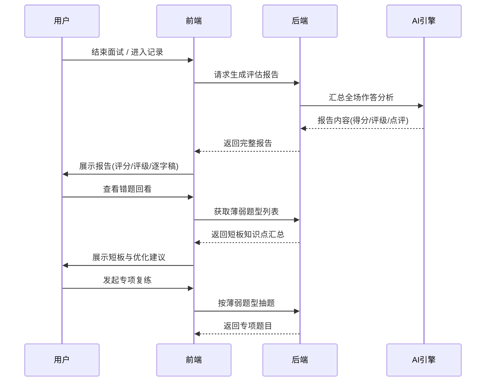
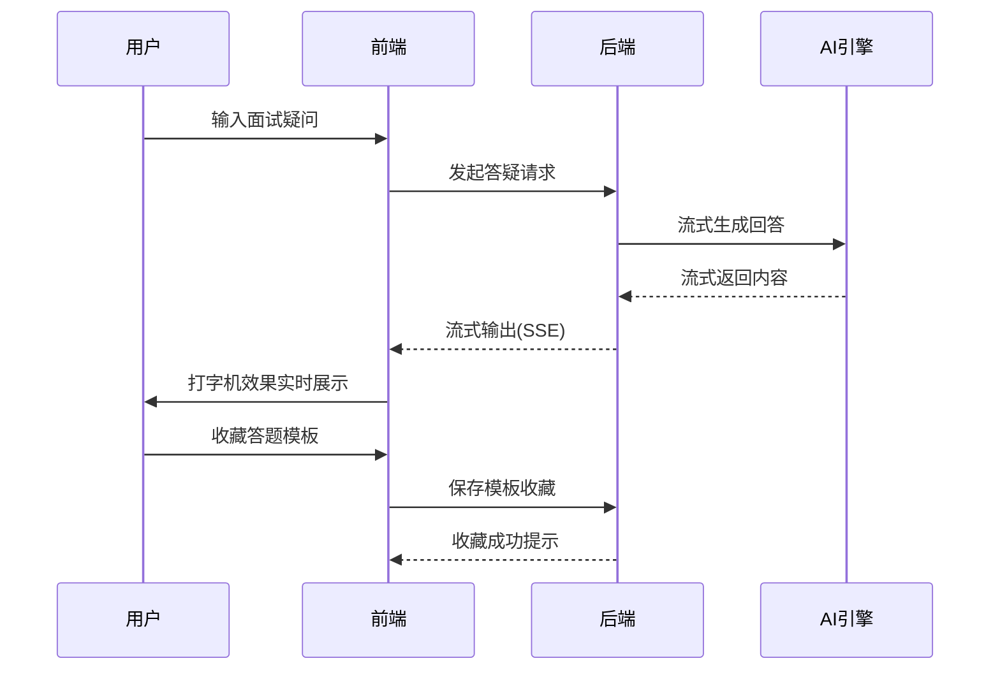
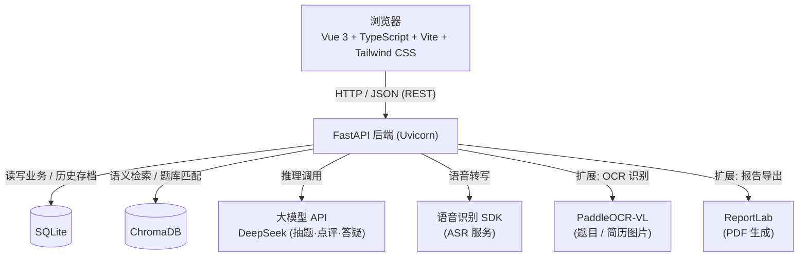

# 面知 · AI 面试陪练工具 — 产品需求文档（PRD）

| 项目 | 内容 |
|---|---|
| 产品名称 | 面知 - AI 面试陪练工具 |
| 文档版本 | V1.0（MVP） |
| 产品形态 | Web 端应用（响应式，桌面优先） |
| 目标用户 | 高校应届生（校招求职） |
| 技术栈 | Vue3 + FastAPI + SQLite + ChromaDB + 大模型 API + 语音识别 SDK |
| 更新日期 | 2026-08-20 |

---

## 一、产品背景与目标

### 1.1 产品背景

高校应届生求职竞争日益激烈，校招面试是决定求职成败的关键环节，但应届生普遍面临四大核心痛点：

| 痛点 | 具体表现 |
|---|---|
| **缺实战** | 身边缺少能扮演 HR 的模拟面试对象，真实面试经验几乎为零 |
| **怕开口** | 紧张、怯场、临场忘词，不敢开口表达 |
| **不知好坏** | 练习后无人点评，不知道答得好不好、差在哪 |
| **难坚持** | 缺乏即时反馈与成长激励，练习难以持续 |

### 1.2 产品定位

面知 是一款面向高校应届生的 **AI 面试模拟陪练平台**，专注校招面试备考。通过**全真岗位面试模拟、AI 智能点评打分、面试问题复盘、能力数据可视化**，帮助应届生快速熟悉面试流程、规范答题逻辑、改掉面试陋习，高效提升校招面试通过率。

### 1.3 产品目标

| 层级 | 目标 |
|---|---|
| 产品目标（MVP） | 数周内上线可演示、可自用的 MVP，跑通「练 → 评 → 改 → 长」核心闭环，覆盖 10 大 MVP 功能 |
| 用户价值 | 面试流程熟悉度提升、答题逻辑规范化、面试陋习可视化纠正、面试能力可量化成长 |
| 平台价值 | 沉淀答题数据资产，积累题库与答题模板内容库，形成数据飞轮 |

### 1.4 核心指标（北极星与关键指标）

| 指标 | 定义 | 目标值 |
|---|---|---|
| 面试练习次数（北极星） | 周人均完成面试场次 | ≥ 2 次/周 |
| 面试完成率 | 开启面试后完成全部流程的比例 | ≥ 80% |
| 错题复练率 | 错题回看后发起专项复练的比例 | ≥ 30% |
| 点评有用性 | 用户对 AI 点评「有用」评价占比 | ≥ 85% |
| 次周留存率 | 首次使用后第 7 天仍在使用的比例 | ≥ 25% |

### 1.5 三大业务主流程

1. **全真面试模拟**：选择岗位题型 → 开启 AI 面试 → 实时答题作答 → AI 实时点评打分
2. **面试复盘分析**：结束面试 → 生成完整报告 → 短板知识点汇总 → 针对性优化建议
3. **AI 问答辅导**：面试疑问提问 → 流式 AI 答疑 → 答题模板一键收藏复用

---

## 二、目标用户画像

### 2.1 核心用户群

- **人群**：高校应届生（大三/大四本科生、研二/研三硕士生）
- **时机**：校招季（秋招 8–11 月、春招 2–5 月）集中备考
- **行业**：互联网、国企、文职、制造业等多行业求职者
- **设备**：以 PC 为主（Web 端），移动端轻量访问

### 2.2 典型用户画像

| 画像 | 背景 | 核心痛点 | 典型使用方式 |
|---|---|---|---|
| **校招小白 · 小林** | 大四应届，第一次参加校招，无面试经验 | 不知道面试问什么、怎么答，紧张忘词 | 从岗位题库起步，普通模式练习，依赖标准答案与结构化模板 |
| **临阵突击 · 小陈** | 已收到面试通知，时间紧迫 | 想快速了解目标岗位高频题与面试节奏 | 用意向岗位题库集中突击，重点用压力面模拟 + 复盘报告 |
| **进阶提升 · 小王** | 已有数轮面试经历，能力不稳定 | 表达逻辑差、口头禅多、得分波动大 | 看数据看板与弱项诊断，做专项训练，收藏模板复用 |

### 2.3 核心使用场景

| 场景 | 触发时机 | 用户行为 |
|---|---|---|
| 日常备战 | 秋招/春招备考期 | 每日 20–30 分钟随机练习 + 查看成长曲线 |
| 考前突击 | 收到面试邀约后 1–3 天 | 目标岗位高频题集中模拟、压力面演练 |
| 复盘提升 | 每次面试结束后 | 查看报告、错题回看、专项复练 |

---

## 三、业务核心逻辑（Mermaid 流程图）

面知 业务以「**练 → 评 → 改 → 长**」能力螺旋为核心闭环，三大流程（全真面试模拟、面试复盘分析、AI 问答辅导）均汇入该闭环：

---

## 四、功能流程描述（Mermaid 流程图）

### 4.1 流程一：全真面试模拟

### 4.2 流程二：面试复盘分析

### 4.3 流程三：AI 问答辅导

---

## 五、功能需求详情

### 5.1 MVP 功能清单总览

| 序号 | 功能模块 | 优先级 | 功能说明 |
|---|---|---|---|
| FR-01 | 岗位题库分类 | P0 | 多行业岗位题库浏览、筛选、检索 |
| FR-02 | 全真面试模拟 | P0 | 普通 / 压力两种模式，AI 扮演 HR 连续提问 |
| FR-03 | 语音 / 文字答题 | P0 | 双模式作答，语音实时转写 |
| FR-04 | 实时 AI 点评 | P0 | 分维度打分 + 等级评定 + 建议 |
| FR-05 | 面试报告生成 | P0 | 结束后自动生成完整评估报告 |
| FR-06 | 面试记录复盘 | P0 | 历史记录存档、错题回看、专项复练 |
| FR-07 | 能力数据看板 | P1 | 成长曲线、能力维度统计 |
| FR-08 | 答题模板库 | P1 | 结构化模板推荐、收藏复用 |
| FR-09 | AI 面试答疑 | P1 | 面试疑问流式 AI 解答 |
| FR-10 | 帮助中心 | P2 | 使用指引、FAQ、反馈入口 |

### 5.2 功能需求详情

#### FR-01 岗位题库分类（P0）

- **功能描述**：按行业（互联网 / 国企 / 文职 / 制造业）与具体岗位分类浏览题库，支持关键词搜索与难度筛选。
- **用户故事**：作为应届生，我希望按目标行业/岗位筛选题库，以便精准练习与意向岗位匹配。
- **详细需求**：
  - 题库列表：岗位名称、所属行业、题型构成（行为 / 专业 / 情景）、难度等级
  - 筛选能力：行业筛选 + 岗位关键词搜索 + 难度筛选
  - 题库卡片：显示题目数量、平均面试时长、高频题标识
  - 意向岗位题库自动匹配（结合用户预设目标岗位）
- **验收要点**：至少 4 大行业题库可浏览；筛选/搜索可用；题库与岗位语义匹配正确。

#### FR-02 全真面试模拟（P0）

- **功能描述**：用户配置岗位、题型、时长、答题方式后开启 AI 面试；AI 扮演 HR 一对一连续提问，模拟真实面试节奏。
- **用户故事**：作为应届生，我希望体验真实面试节奏，以便提前适应并降低紧张感。
- **详细需求**：
  - **普通模式**：常规提问节奏，题目难度适中，时长可配置（10 / 15 / 20 分钟）
  - **压力模式**：AI 追问打断、节奏加快、增加刁钻问题，训练抗压与临场应变
  - **面试配置项**：岗位、题型、面试时长、答题方式（语音 / 文字）
  - **面试进行**：顶部计时组件、题目进度（第 N / 总题数）、暂停 / 换题 / 跳过 / 结束
  - **结尾环节**：确认结束 → 触发报告生成
- **验收要点**：两种模式均可正常开启；提问节奏符合模式设定；计时准确；可随时结束。

#### FR-03 语音 / 文字答题（P0）

- **功能描述**：支持语音与文字双模式作答；语音答题实时转写为文字并纳入 AI 点评。
- **用户故事**：作为应届生，我希望用语音答题贴近真实面试，也能用文字答题方便组织思路。
- **详细需求**：
  - 文字模式：多行输入框、字数统计、提交 / 重答
  - 语音模式：录音按钮、录制波形动画、实时转写、转写结果可编辑
  - 作答过程：显示剩余答题时间，可提前提交
  - 转写文本进入 AI 点评流程，与文字作答等价
- **验收要点**：两种模式可自由切换；语音转写准确率 ≥ 90%；转写响应 < 3s。

#### FR-04 实时 AI 点评（P0）

- **功能描述**：每次答题后 AI 实时点评并打分，多维度评分 + 等级评定 + 改进建议。
- **用户故事**：作为应届生，我希望答题后立刻知道好坏，以便当场改进。
- **详细需求**：
  - **评分维度**：内容完整性、逻辑性、表达流畅度、岗位匹配度、抗压能力（5 维）
  - **综合得分**：0–100 分 + 等级（S / A / B / C / D）
  - **点评内容**：亮点 + 存在问题 + 改进建议三段式
  - **附加检测**：语速检测（字/分）、口头禅识别（频次提示）
  - **模板推荐**：根据题型智能推荐结构化模板（STAR / 金字塔 / PREP）
- **验收要点**：点评生成 < 3s；评分附带可解释理由；语速/口头禅检测数据正确。

#### FR-05 面试报告生成（P0）

- **功能描述**：面试结束后自动生成完整评估报告并持久化存档。
- **用户故事**：作为应届生，我希望面试后拿到完整报告，全面了解本场表现。
- **详细需求**：
  - 报告内容：综合得分、等级、5 维分项得分、完整 AI 点评、答题逐字稿、错题列表、优化建议
  - 逐字稿：支持按题回看语音转写 / 文字作答内容
  - 报告导出：支持打印 / 保存（PDF 导出预留）
- **验收要点**：报告内容完整、数据与面试过程一致；逐字稿可查看。

#### FR-06 面试记录复盘（P0）

- **功能描述**：保存每次面试记录，支持历史回看、薄弱题型标记与错题专项复练。
- **用户故事**：作为应届生，我希望回看历史面试记录、找出薄弱题型反复练习。
- **详细需求**：
  - 记录列表：日期、岗位、得分、等级、模式、状态（已复盘 / 未复盘）
  - 记录详情：完整报告回看 + 逐字稿
  - 错题本：自动标记薄弱题型，错题列表 + 薄弱知识点汇总
  - 专项复练：按薄弱题型一键重新抽题练习
- **验收要点**：记录完整保存可回看；错题可一键专项复练；支持千条以上记录存储。

#### FR-07 能力数据看板（P1）

- **功能描述**：可视化展示个人面试能力成长趋势与维度分布。
- **用户故事**：作为应届生，我希望看到能力成长曲线，增强信心与坚持动力。
- **详细需求**：
  - 成长折线图：综合 / 表达 / 逻辑多维度趋势（随场次更新）
  - 能力维度统计：5 维能力横条（最新一场）
  - 历史面试汇总表：日期 / 岗位 / 得分 / 等级 / 模式 / 状态
- **验收要点**：图表数据与面试记录一致；每场面试后实时更新。

#### FR-08 答题模板库（P1）

- **功能描述**：提供结构化答题模板（STAR / 金字塔 / PREP 等），支持面试中智能推荐与收藏复用。
- **用户故事**：作为应届生，我希望按模板规范答题逻辑，并收藏好用的模板随时复用。
- **详细需求**：
  - 模板列表：模板名称、适用题型、结构说明
  - 模板详情：结构拆解 + 示例 + 应用场景
  - 面试中推荐：按当前题型推荐对应模板
  - 收藏复用：一键收藏进「我的模板」，作答时可参考
- **验收要点**：模板与题型匹配正确；收藏后可在作答区复用。

#### FR-09 AI 面试答疑（P1）

- **功能描述**：面试疑问随时提问，AI 流式答疑，回答可收藏为答题模板。
- **用户故事**：作为应届生，我希望遇到面试疑问时能随时获得解答并沉淀复用。
- **详细需求**：
  - 答疑入口：独立答疑页 + 面试进行中快捷提问
  - 流式输出：打字机效果逐字展示（SSE）
  - 模板沉淀：回答可一键收藏为答题模板
- **验收要点**：流式输出流畅无卡顿；回答可收藏并在模板库可见。

#### FR-10 帮助中心（P2）

- **功能描述**：产品使用指引、FAQ 常见问题与意见反馈入口。
- **用户故事**：作为应届生，我希望快速了解产品怎么用、遇到问题能自助解决。
- **详细需求**：
  - 三步上手指引（选岗位 → 开面试 → 看报告）
  - FAQ 列表（支持关键词搜索）
  - 意见反馈入口（提交反馈表单）
- **验收要点**：指引清晰完整；FAQ 覆盖核心使用问题。

---

## 六、非功能需求

| 类别 | 需求描述 | 指标要求 |
|---|---|---|
| 性能 | API 接口响应时间 | 平均 < 500ms |
| 性能 | AI 点评 / 语音转写生成时间 | < 3s（约 2–3s 内返回） |
| 性能 | 首屏加载时间 | < 2s |
| 容量 | 面试记录存储 | 单用户支持千条以上记录，查询不卡顿 |
| 缓存 | 本地数据缓存 | 题库、模板、用户设置本地缓存，弱网可用 |
| 兼容性 | 浏览器支持 | Chrome / Edge / Firefox / Safari 近两个主流版本 |
| 响应式 | 布局适配 | Web 端响应式：桌面（≥1024px）优先，适配平板（768–1024px） |
| 安全 | 数据安全 | 用户数据加密存储、不外泄；大模型请求不泄露敏感信息 |
| 可靠性 | 服务可用性 | MVP 阶段可用性 ≥ 99.5% |
| 可用性 | 异常兜底 | 语音识别失败可切换文字；大模型超时可重试；面试中断可续接 |

---

## 七、验收标准

### 7.1 功能验收标准（对应 MVP 功能）

| 编号 | 验收项 | 验收标准 |
|---|---|---|
| AC-01 | 岗位题库分类 | 至少 4 大行业题库；行业/难度筛选、关键词搜索均可用；意向岗位题库匹配正确 |
| AC-02 | 全真面试模拟 | 普通 / 压力模式均可开启；计时与进度准确；AI 连续提问符合真实节奏 |
| AC-03 | 语音 / 文字答题 | 双模式均可作答并提交；语音转写准确率 ≥ 90%；转写响应 < 3s |
| AC-04 | 实时 AI 点评 | 每道题均返回评分 + 等级 + 三段式点评；语速/口头禅数据正确 |
| AC-05 | 面试报告生成 | 结束后自动生成报告；得分、评级、逐字稿与过程一致 |
| AC-06 | 面试记录复盘 | 历史记录完整可回看；薄弱题型标记正确；错题可一键专项复练 |
| AC-07 | 能力数据看板 | 成长曲线与维度统计随练习实时正确更新 |
| AC-08 | 答题模板库 | 模板可按题型推荐；收藏、复用流程可用 |
| AC-09 | AI 面试答疑 | 提问有流式回答；回答可收藏并同步至模板库 |
| AC-10 | 帮助中心 | 使用指引与 FAQ 可访问；FAQ 覆盖核心问题 |

### 7.2 非功能验收标准

| 编号 | 验收项 | 验收标准 |
|---|---|---|
| AC-11 | 性能 | API P95 响应 < 500ms；AI 点评/转写 < 3s；首屏 < 2s（4G 网络） |
| AC-12 | 容量 | 单用户千条面试记录列表与详情查询无明显卡顿 |
| AC-13 | 兼容性 | 主流浏览器最新两版无功能性错误、布局不破版 |
| AC-14 | 响应式 | 桌面 / 平板断点布局正常，核心流程可用 |
| AC-15 | 异常兜底 | ASR 失败可切换文字作答；面试中断可恢复续接；大模型超时自动重试 |

---

## 八、技术方案概要

### 8.1 总体架构

前后端分离 SPA 架构，单机可部署、低成本运行：

### 8.2 技术选型

| 层 | 选型 | 选择理由 |
|---|---|---|
| 前端 | Vue 3 + TypeScript + Vite + Tailwind CSS | 上手快、生态成熟、开发效率高 |
| 后端 | FastAPI + Uvicorn | Python 异步高性能、自动文档、易维护 |
| 数据库 | SQLite | 零运维、文件型存储，MVP 阶段成本最低 |
| 向量数据库 | ChromaDB | 本地轻量，支撑题库语义检索与岗位匹配 |
| 大模型 API | DeepSeek API | 成本低、中文能力强，承担抽题/点评/答疑 |
| 语音识别 | 语音识别 SDK（腾讯云 / 讯飞 ASR） | 语音答题实时转写 |
| OCR（扩展） | PaddleOCR-VL | 题目/简历图片文字识别 |
| PDF（扩展） | ReportLab | 面试报告导出 PDF |

### 8.3 关键设计要点

| 要点 | 设计说明 |
|---|---|
| 接口风格 | REST API；AI 点评 / 答疑采用 SSE 流式输出，提升实时体验 |
| 题库匹配 | 题目入库 + ChromaDB 向量化，按意向岗位做语义匹配随机抽题 |
| 语音链路 | 前端录音 → 上传后端 → 调 ASR 转写 → 转写文本进入点评与存档 |
| 面试状态机 | 配置 → 提问 → 作答 → 点评 → 下一题 →（结束）→ 报告生成，中断可恢复 |
| 本地缓存 | 题库元数据、模板、设置本地缓存，弱网可用 |
| 部署 | MVP 单机部署（Docker 可选），SQLite 文件存储，成本可控 |

---

## 附录：MVP 范围界定

| 范围 | 内容 |
|---|---|
| ✅ MVP 内 | FR-01 ~ FR-06（P0 六项）+ FR-07 / 08 / 09（P1 三项，看板与模板为差异化亮点） |
| ⏸ MVP 后可迭代 | FR-10 帮助中心完善、PDF 报告导出、摄像头形象面、连续打卡成就、面试日历提醒 |
| 🚫 明确不做（MVP） | 移动端 App、多人/班级模式、付费题库、企业端 HR 后台 |
