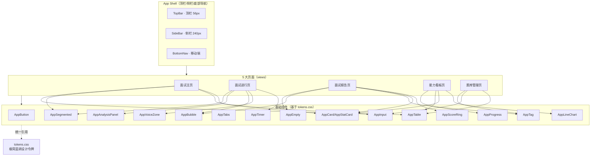
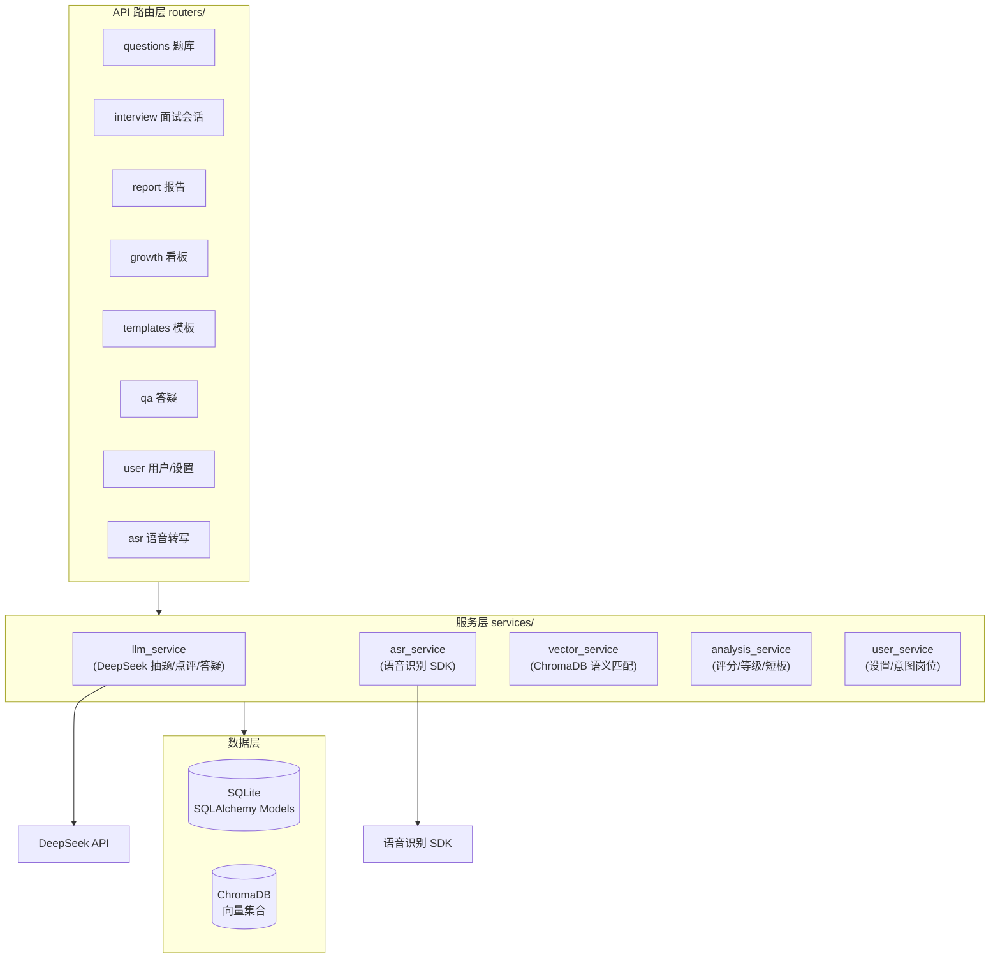
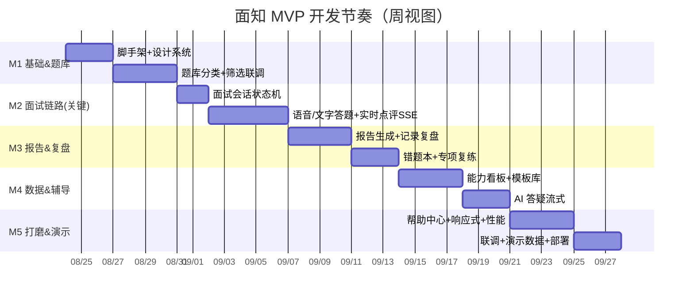

# 面知 · AI 面试陪练工具 — 开发规划文档

| 项目 | 内容 |
|---|---|
| 产品名称 | 面知 - AI 面试陪练工具 |
| 文档类型 | 开发规划（基于 PRD V1.0 + UI/UX Design System） |
| 适用对象 | 个人/小团队开发者（低成本、数周可演示 MVP） |
| 技术栈 | Vue3 + TS + Vite + Tailwind / FastAPI + Uvicorn / SQLite / ChromaDB / DeepSeek API / 语音识别 SDK |
| 更新日期 | 2026-08-20 |

---

## 一、开发总纲

### 1.1 项目定位与原则

| 维度 | 约定 |
|---|---|
| 形态 | Web 端 SPA（桌面优先，响应式至平板/移动） |
| 核心目标 | 数周内交付可演示、可自用的 MVP，跑通「练 → 评 → 改 → 长」闭环 |
| 成本控制 | 全部选型零/极低费用：SQLite 文件库、ChromaDB 本地向量库、DeepSeek 按量计费、开源 ASR |
| 个人开发者适配 | 前后端分离但单机可跑；优先复用成熟库，避免自研算法；UI 复用 Design System 组件 |
| 质量底线 | 不符合 UI 规范（无阴影/双字重/令牌色）的页面一律回炉；跨页面数值不一致为 P0 缺陷 |

### 1.2 MVP 范围边界

- **MVP 内（必做）**：FR-01 岗位题库分类、FR-02 全真面试模拟、FR-03 语音/文字答题、FR-04 实时 AI 点评、FR-05 面试报告、FR-06 记录复盘、FR-07 数据看板、FR-08 模板库、FR-09 AI 答疑
- **MVP 内（低优）**：FR-10 帮助中心
- **MVP 后迭代**：PDF 报告导出、OCR 题目识别、摄像头形象面、打卡成就、面试日历、企业端
- **明确不做**：移动端 App、多人/班级模式、付费题库、HR 后台

### 1.3 代码组织约定

```
面知/
├── frontend/                 # Vue3 + Vite
│   ├── src/
│   │   ├── design/tokens.css # 设计令牌（取自 Design System）
│   │   ├── components/       # App 前缀组件（见第三章）
│   │   ├── views/            # 5 大页面
│   │   ├── api/              # 接口封装（fetch + SSE）
│   │   ├── stores/           # 状态（Pinia）
│   │   └── utils/            # 计时器/格式化
│   └── index.html
├── backend/                  # FastAPI
│   ├── app/
│   │   ├── routers/          # 路由分层
│   │   ├── services/         # llm/asr/vector/analysis
│   │   ├── models.py         # SQLAlchemy / SQLite
│   │   ├── schemas.py        # Pydantic
│   │   └── db.py             # SQLite + ChromaDB 客户端
│   └── main.py
└── data/                     # SQLite 文件 + ChromaDB 持久化
```

---

## 二、里程碑与任务分解

> 个人开发者节奏：约 **5 周**（每周 1 里程碑），关键路径为 M2 面试会话链路。

| 里程碑 | 周期 | 目标 | 关联功能 |
|---|---|---|---|
| **M1 基础骨架 & 题库** | 第 1 周 | 项目脚手架、设计系统落地、题库分类可浏览筛选 | FR-01, FR-10 骨架 |
| **M2 全真面试核心链路** | 第 2 周 | 面试会话状态机、语音/文字答题、AI 实时点评 | FR-02, FR-03, FR-04 |
| **M3 报告 & 复盘** | 第 3 周 | 报告生成、记录存档、错题本与专项复练 | FR-05, FR-06 |
| **M4 数据 & 辅导** | 第 4 周 | 能力看板、模板库、AI 答疑 | FR-07, FR-08, FR-09 |
| **M5 打磨 & 演示** | 第 5 周 | 帮助中心、响应式、性能、联调、演示版 | FR-10, 非功能 |

### 2.1 各里程碑任务分解

**M1｜基础骨架 & 题库**
- 前端：脚手架（Vite+Vue+TS+Tailwind）、`tokens.css` 落地、App Shell（顶栏 56/侧栏 240）、面试主页（岗位筛选+卡片列表）、题库分类
- 后端：`/questions` 列表与筛选、SQLite 题库表与种子数据、ChromaDB 建库与向量化（4 行业）
- 联调：题库浏览、筛选、搜索

**M2｜全真面试核心链路（关键路径）**
- 前端：面试进行页（顶栏+计时条+三栏）、计时器、文字/语音 seg、录音波形、实时分析面板
- 后端：面试会话状态机、`/interview/start`、`/asr` 语音转写、`/answer` 提交、点评 SSE 流式接口（调 DeepSeek）
- 联调：开启面试→逐题作答→实时点评全链路

**M3｜报告 & 复盘**
- 前端：报告页（得分环+分项+错题卡+点评+建议）、记录列表、错题本、专项复练入口
- 后端：`/report` 生成与查询、`/interviews` 列表、薄弱题型标记与专项抽题
- 联调：结束→报告→复盘→复练闭环

**M4｜数据 & 辅导**
- 前端：能力看板（KPI+成长折线+维度条+历史表）、模板库、AI 答疑页（流式）
- 后端：`/growth` 聚合、`/templates` 推荐与收藏、答疑 SSE 接口
- 联调：看板数据自洽、模板收藏、答疑流式

**M5｜打磨 & 演示**
- 前端：帮助中心、移动端底部导航与响应式适配、空状态、加载态
- 后端：本地缓存策略、异常兜底（ASR 失败降级文字/大模型超时重试）、性能优化（接口 <500ms）
- 收尾：跨页面数值一致性校验、演示数据、部署脚本

---

## 三、组件 / 模块依赖树

### 3.1 前端模块依赖树



### 3.2 后端模块依赖树



### 3.3 关键数据流依赖

- **面试进行页** 依赖：`interview/start` → `asr`（语音）→ `answer` → 点评 SSE；右侧实时分析面板依赖 SSE 增量更新
- **报告页 / 看板页 / 历史表** 同源：均读 `interview_reports` + `interview_answers`，必须保证圆环分=等级=分项均值=历史得分一致（见 PRD 内容一致性铁律）
- **成长折线** 终点值 = 最新一场 `composite_score`

---

## 四、API 契约

> 基础约定：前缀 `/api/v1`；REST 用 JSON；流式（点评/答疑）用 **SSE**（`text/event-stream`）；统一响应 `{code, msg, data}`；错误码 `4xx/5xx` 带 `detail`。

### 4.1 题库与用户

| 方法 | 路径 | 说明 | 关键入参 / 出参 |
|---|---|---|---|
| GET | `/questions` | 题库列表/筛选 | `?industry=&position=&type=&difficulty=&q=&page=` → `{items[], total}` |
| GET | `/questions/{id}` | 题目详情 | → `{id, text, type, difficulty, refAnswer, points[], tags[]}` |
| GET | `/user/settings` | 取用户设置 | → `{intentIndustry, intentPosition, preferences}` |
| PUT | `/user/settings` | 改设置 | body 同上 → `{ok}` |
| POST | `/user/intent` | 设定意向岗位 | body `{industry, position}` → 触发题库语义匹配 |

### 4.2 面试会话（核心链路）

| 方法 | 路径 | 说明 | 关键入参 / 出参 |
|---|---|---|---|
| POST | `/interview/start` | 开启面试 | body `{position, industry, mode, duration, answerMode}` → `{sessionId, questions[]}` |
| POST | `/asr` | 语音转写 | `multipart audio` → `{text}`（失败返回 `code:ASR_FAIL` 由前端降级文字） |
| POST | `/interview/{sid}/answer` | 提交作答 | body `{questionId, mode, text}` → `{answerId}` |
| POST | `/interview/{sid}/answer/{aid}/evaluate` | **SSE** 实时点评 | → `data:{score, dims{content,logic,expression,match,resilience}, grade, comment, speedWpm, fillers[], template}` |
| POST | `/interview/{sid}/end` | 结束面试 | → `{reportId}` |

> 评分维度固定 5 项：`content`(内容) / `logic`(逻辑) / `expression`(表达) / `match`(岗位匹配) / `resilience`(抗压)。等级：`S/A/B/C/D`。

### 4.3 报告、复盘与成长

| 方法 | 路径 | 说明 | 关键入参 / 出参 |
|---|---|---|---|
| GET | `/interview/{sid}/report` | 完整报告 | → `{composite, grade, dims, highlights[], weaknesses[], suggestions[], transcript[]}` |
| GET | `/interviews` | 历史列表 | `?page=&status=` → `{items[{date,position,score,grade,mode,status}], total}` |
| GET | `/weakness` | 薄弱题型 | `?type=` → `{wrongItems[{questionId, type, score, note}]}` |
| POST | `/interview/{sid}/practice/weak` | 专项复练抽题 | body `{type}` → `{questions[]}` |
| GET | `/growth` | 能力看板 | → `{trend[{date,composite,expression,logic}], dims{}, stats{avgScore,count,improve,topGrade}}` |

### 4.4 模板与答疑

| 方法 | 路径 | 说明 | 关键入参 / 出参 |
|---|---|---|---|
| GET | `/templates` | 模板列表 | `?type=` → `{items[{id,name,structure,applicableTypes,example}]}` |
| POST | `/templates/{id}/collect` | 收藏模板 | → `{ok}` |
| POST | `/qa` | **SSE** 面试答疑 | body `{question, history?}` → `data:{chunk}`（回答可收藏为模板） |

### 4.5 数据模型（SQLite 核心表）

```
users(id, intent_industry, intent_position, created_at)
questions(id, industry, position, type, difficulty, text, ref_answer, points, tags, source)
interview_sessions(id, user_id, position, industry, mode, duration, total, status, created_at)
interview_answers(id, session_id, question_id, type, mode, answer_text, asr_text,
                  score, dims_json, grade, comment, speed_wpm, fillers_json, template)
interview_reports(id, session_id, composite, grade, dims_json, highlights_json,
                  weaknesses_json, suggestions_json, transcript_json, created_at)
templates(id, name, structure, applicable_types, example)
user_templates(user_id, template_id, collected_at)
```

---

## 五、开发规范

### 5.1 前端规范（对齐 UI Design System）

| 项 | 强制规则 |
|---|---|
| 设计令牌 | 所有颜色/间距/圆角取值来自 `tokens.css`（主色 `#007AFF`、背景 `#F5F5F7`、边框 `#E5E5EA`、文字三级），**禁止硬编码色值** |
| 无阴影 | 除输入框聚焦环 `0 0 0 3px rgba(0,122,255,.12)` 外，**禁止任何 box-shadow** |
| 字重 | 仅 `400` / `600`，禁止 `300` / `700` |
| 圆角 | 仅 6 / 8 / 12 / 9999（`--radius-sm/md/lg/full`） |
| 间距 | 8px 栅格：`xs4 sm8 md12 lg16 xl24 2xl32 3xl48` |
| 组件命名 | PascalCase + `App` 前缀（`AppButton`、`AppScoreRing`），单文件组件 SFC |
| 类型 | TypeScript `strict: true`，接口请求/响应定义 `interface` 并与后端 schema 对齐 |
| 响应式 | 桌面(≥1024)展开侧栏 / 平板(768–1024)64px 图标 / 移动(<768)底部导航；断点参考 Design System |
| 图标 | 线框 SVG（导航 20 / 内容 16 / 按钮 14，线宽 1.5），禁止混用图标库 |
| 文案 | 对学生鼓励、口语化；数值跨页一致（同场面试得分/等级/分项全局唯一） |

### 5.2 后端规范

| 项 | 强制规则 |
|---|---|
| 分层 | `routers`（薄）→ `services`（业务）→ `models/schemas`（数据/校验）；禁止在路由写业务 |
| 校验 | 入参一律 Pydantic `BaseModel`；枚举限制 mode(普通/压力)、grade(S/A/B/C/D) |
| 异步 | I/O（DB、外部 API）一律 `async`，`await`；SQLite 用 `aiosqlite` 或同步池隔离 |
| 统一响应 | `{code:0, msg:"ok", data:{}}`；业务异常映射错误码（ASR_FAIL / LLM_TIMEOUT / NOT_FOUND） |
| 流式 | 点评/答疑用 `StreamingResponse` + SSE，单次生成超时设 3s 重试/兜底 |
| 日志 | 结构化日志（请求 id、耗时），接口 P95 < 500ms 监控 |
| 配置 | 密钥（DeepSeek Key、ASR Key）走环境变量，禁止入库/硬编码 |

### 5.3 工程规范

| 项 | 约定 |
|---|---|
| 分支 | `main`（可演示）/ `dev`（开发）/ `feature/*`（按功能），个人开发者可简化为 main + feature |
| 提交 | `feat: / fix: / docs: / refactor: / style:` 前缀；关联里程碑 |
| 联调 | 前端 `npm run dev` 代理 `/api` 到 FastAPI；后端 `uvicorn` 热重载 |
| 评审清单 | 组件是否复用 Design System？有无非法 box-shadow？跨页数值一致？接口有 schema 校验？ |

---

## 六、风险矩阵

| 编号 | 风险 | 类别 | 概率 | 影响 | 等级 | 应对策略 |
|---|---|---|---|---|---|---|
| R1 | DeepSeek 点评延迟/超时 | 技术 | 中 | 高 | 🔴 高 | 设 3s 超时+重试+兜底模板点评；SSE 流式降低体感延迟；前端 loading 态 |
| R2 | 语音识别（ASR）准确率不足/失败 | 技术 | 中 | 中 | 🟠 中 | 失败自动降级文字作答；转写结果可编辑；选稳定云 ASR SDK |
| R3 | ChromaDB 本地部署/向量检索偏差 | 技术 | 低 | 中 | 🟡 低 | 种子数据小，先用 SQLite 关键词+简单向量双路；建库前回测匹配质量 |
| R4 | 跨页面数值不一致（报告/看板/历史） | 质量 | 中 | 高 | 🔴 高 | 唯一数据源 `interview_reports`；前端只读同源；加一致性单测 |
| R5 | 实时点评与前端面板更新不同步 | 技术 | 中 | 中 | 🟠 中 | SSE 增量协议明确字段；前端乐观更新+最终态对账 |
| R6 | 压力面追问逻辑生硬 | 产品 | 中 | 中 | 🟠 中 | 预设追问模板库 + DeepSeek 条件触发；先规则后模型 |
| R7 | 个人开发者时间/精力不足 | 项目 | 中 | 高 | 🔴 高 | MVP 聚焦 P0；非核心功能后置；复用 Design System 组件省 UI 时间 |
| R8 | 外部 API 成本/限流 | 成本 | 低 | 中 | 🟡 低 | DeepSeek 限频+缓存高频题点评；题库预生成点评降低实时调用 |
| R9 | 移动端布局破版/触控区过小 | 质量 | 中 | 中 | 🟠 中 | 按 Design System 响应式表；按钮/输入最小 44px；真机实测 |

> 等级：🔴 高（必须前置应对，纳入冲刺首条）、🟠 中（实现时规避）、🟡 低（监控即可）。

---

## 七、验收标准

### 7.1 功能验收（承接 PRD AC-01~15）

| 编号 | 验收项 | 标准 |
|---|---|---|
| AC-01 | 岗位题库分类 | 4 行业题库可浏览；行业/难度筛选、搜索可用；意向岗位匹配正确 |
| AC-02 | 全真面试模拟 | 普通/压力模式可开启；计时与进度准确；AI 连续提问符合节奏 |
| AC-03 | 语音/文字答题 | 双模式可答；语音转写准确率 ≥90%；转写响应 <3s |
| AC-04 | 实时 AI 点评 | 每题返回 5 维评分+等级+三段式点评；语速/口头禅正确 |
| AC-05 | 面试报告生成 | 结束自动生成；得分/评级/逐字稿与过程一致 |
| AC-06 | 记录复盘 | 记录可回看；薄弱题型标记正确；错题可专项复练 |
| AC-07 | 能力数据看板 | 成长曲线/维度统计随练习实时正确更新 |
| AC-08 | 答题模板库 | 模板按题型推荐；收藏复用可用 |
| AC-09 | AI 面试答疑 | 提问有流式回答；可收藏至模板库 |
| AC-10 | 帮助中心 | 使用指引与 FAQ 可访问；覆盖核心问题 |
| AC-11 | 性能 | API P95 <500ms；点评/转写 <3s；首屏 <2s |
| AC-12 | 容量 | 单用户千条记录查询无卡顿 |
| AC-13 | 兼容性 | 主流浏览器近两版无功能错误 |
| AC-14 | 响应式 | 桌面/平板/移动布局正常、核心流程可用 |
| AC-15 | 异常兜底 | ASR 失败降级文字；中断可恢复；LLM 超时重试 |

### 7.2 开发专项验收（代码质量）

| 维度 | 标准 |
|---|---|
| UI 规范符合度 | 零违规 box-shadow；色值 100% 取自令牌；字重仅 400/600；圆角仅四级 |
| 组件复用 | 5 大页面复用 `App*` 基础组件，无重复样式块 |
| API 契约 | 所有接口与第四章契约一致；入参 Pydantic 校验；SSE 字段齐 |
| 数据一致性 | 同场面试综合分/等级/分项在报告、看板、历史三处完全一致（自动化校验通过） |
| 测试 | 核心链路（start→answer→evaluate→report）E2E 通过；薄弱标记单测通过 |
| 可演示 | `npm run dev` + `uvicorn` 一键起；含演示数据；断网降级可用 |

---

## 八、开发节奏建议

### 8.1 5 周排期（个人开发者）



### 8.2 每日节奏（建议）

- **上午（专注开发）**：攻克当日关键路径任务（如 SSE 点评、状态机）
- **下午（联调/UI）**：前后端联调、按 Design System 落地页面组件
- **晚间（收尾）**：单测/一致性校验、更新里程碑看板、记录风险

### 8.3 关键路径与并行建议

- **关键路径**：M2（面试会话+实时点评）决定主链路可用性，优先排满、不被其他任务阻塞
- **可并行**：M1 题库种子数据（后端）与前端 App Shell 可同步；M4 看板前端可与 M3 复练后端并行
- **演示优先**：每一里程碑结束都需「可点开看」；M2 结束即具备「开一场面试」演示能力
- **技术债控制**：UI 违规（阴影/硬编码色）即时还，避免末期集中返工

### 8.4 演示准备清单

- [ ] 演示账号含 3–5 场历史面试（支撑看板曲线）
- [ ] 4 行业题库各 ≥3 岗位，标注题型/难度
- [ ] 普通面 + 压力面各一段录屏脚本
- [ ] 弱网/ASR 失败降级演示
- [ ] 一键启动脚本（`start.sh`：起后端+前端+种库）

---

## 附录：源文档映射

| 本文章节 | 源文档依据 |
|---|---|
| 一 开发总纲 | PRD §1 目标/§6 非功能；Design System 全局规范 |
| 二 里程碑 | PRD §5.1 功能清单优先级 P0/P1/P2 |
| 三 依赖树 | Design System §5–7 组件/布局/响应式；面知-ui-generator page-templates |
| 四 API 契约 | PRD §4 流程（start→answer→evaluate→report）/§8 架构；FR-01~10 |
| 五 开发规范 | Design System 色彩/字体/间距/圆角/组件铁律 |
| 六 风险矩阵 | PRD 非功能难点 + 个人开发者约束 |
| 七 验收标准 | PRD §7 AC-01~15 直接继承并扩充代码质量项 |
| 八 节奏建议 | PRD 北极星指标 + 低成本数周上线约束 |
